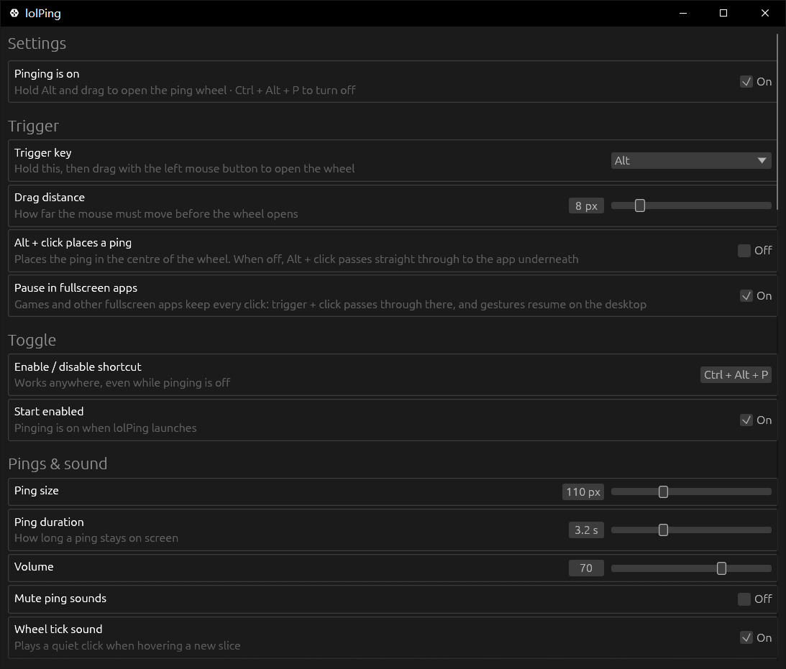

<h1 align="center"><br>lolPing</h1>

<p align="center">
  English | <a href="README.zh-CN.md">简体中文</a>
</p>

<p align="center">
  League of Legends pings and emotes for your whole desktop, on Windows.<br>
  Hold <b>Alt</b>, drag, and let go on a ping. The animation pops and the sound plays on top of any app, on any monitor.<br>
  Hold <b>Ctrl</b> and drag for the emote wheel: League's emotes, or your own images.
</p>

<p align="center">
  <a href="https://github.com/SlimeSB/lolPing-rust/releases/latest"><b>Download for Windows</b></a>
</p>

<p align="center">
  <a href="https://github.com/SlimeSB/lolPing-rust/releases/latest"></a>
  <a href="LICENSE"></a>
</p>

<p align="center"></p>

Pings and emotes show up in whole-screen capture, so friends watching your Discord or OBS stream see them too. lolPing is a desktop toy: it doesn't read, change or hook into League itself.

## Install

lolPing is `lolPing.exe` plus the `assets` folder it reads at runtime. Keep the two together: a shipped copy loads its icons, sounds and emotes from `assets` next to the exe.

1. Get `lolPing.exe` and `assets` from the [latest release](https://github.com/SlimeSB/lolPing-rust/releases/latest), or build them yourself (see [Build from source](#build-from-source)).
2. Run `lolPing.exe`. It opens its settings window and moves to the tray.
3. Hold Alt and drag anywhere to ping.

The exe is built for 64-bit Windows. Starting it again while it is already running only brings up the settings window of the copy that is up.

## Use

| To | Do this |
| --- | --- |
| Ping | Hold **Alt**, drag, and let go on a slice |
| Emote | Hold **Ctrl**, drag, and let go on an emote |
| Cancel | Let go in the centre, right-click, or press **Esc** |
| Pause or resume pinging | **Ctrl + Alt + P** |
| Open settings | Click the tray icon, or right-click it and choose **Settings…** |
| Quit | Right-click the tray icon and choose **Quit lolPing** |
| Restart the input helper | Right-click the tray icon and choose **Restart input helper**, offered only once the helper has stopped |

The wheel, from the top going clockwise: Danger, Push, On My Way, All In, Assist Me, Need Vision, Enemy Missing, Enemy Vision. You can rearrange it and add Bait or Vision Cleared in settings. The emote wheel has 8 slots too, and you pick its emotes in settings.

## Settings



- **Trigger key:** Alt by default. Also offered: Ctrl, Shift, Win, Caps Lock, Mouse 4, Mouse 5 and any other key. A custom key won't type in other apps while pinging is on.
- **Drag distance:** how far the mouse must move before the wheel opens (2 to 40 px, 8 by default).
- **Alt + click places a ping:** off by default, so ordinary Alt + click shortcuts keep working. It places the ping in the centre of the wheel (Generic unless you change it).
- **Enable / disable shortcut:** Ctrl + Alt + P by default. It must include Ctrl, Alt or Win.
- **Start enabled:** pinging is on when lolPing launches.
- **Pings & sound:** ping size (60 to 220 px), how long a ping stays on screen (1 to 8 s), volume, mute and the wheel's tick sound.
- **Wheel:** pick a ping for each of the 8 slices and one for the centre, which is the Alt + click ping. Click a ping in **All pings** to preview it. **Reset to default** brings back League's layout.
- **Emotes:** the emote key (Ctrl by default, or Off), **Ctrl + click places an emote** (off by default), emote size, emote sounds and the 8 slot emote wheel, edited like the ping wheel. **Add image…**, or dropping an image on the window, adds your own: PNG, JPG, GIF or WebP, up to 8 MB and 8192 pixels on the longest side (an animation up to 5 MB and 1024 pixels), 24 at most. Animated images keep playing here; friends can't see your imported images.
- **Room:** your name and tag colour, **Mute room**, the incoming ping and emote limit, **Allow internet connections**, **Rejoin last room on launch**, and the displays a ping can land on.
- **App:** **Launch at Windows startup** (starts hidden in the tray) and **Language** (Follow Windows, English or 简体中文).
- **About:** the version, anything missing or broken, and the known limitations.

Settings are saved in `%APPDATA%\lolPing\settings.json`, and your imported images in `%APPDATA%\lolPing\emotes`.

## Ping with friends (rooms)

Join a room and everyone in it sees your pings on their own screen, at the same spot (scaled to their resolution), with your name under them. Their pings show up on yours.

1. One person opens **Settings → Room** (or right-clicks the tray icon → **Room**) and clicks **Create room**.
2. They copy the code, such as `PING-7KQ4M-2HXTR`, and send it to friends.
3. Each friend pastes it into the Room page and clicks **Join**, or right-clicks the tray icon and clicks **Join from clipboard**.

- **Same network:** the first time, Windows asks whether lolPing may use the network: allow it, and set your Wi‑Fi to **Private**. If lolPing can't open UDP port 47474, the Room page says so.
- **Different networks:** with **Allow internet connections** on (the default), friends anywhere join with the same code. Their pings travel through free public [Nostr](https://nostr.com) relays, which take a moment longer than the local network that is used whenever it works.
- A ping lands on the display with the same number (1 is the primary display), or on display 1.
- **Emotes** travel like pings: friends see yours on their own screen with your name under it. Your imported images show as a placeholder on their screen. Friends on a version older than 0.5.0 don't see emotes, and the Room page says so under their names.
- **Mute room**, muting one person, and an **Incoming ping and emote limit** (Unlimited at the top, counted for pings and emotes together) keep the spam under control. Pausing lolPing with the shortcut pauses room pings and emotes too.
- A room holds up to 8 people. Leave and create a new room to get rid of someone.
- **Privacy:** pings, emotes and names are end-to-end encrypted, with the key derived from the room code. People on your network can see your local IP address. With internet connections on, public relays see your IP address, an anonymous room ID and when you send, but never your pings, emotes or name.

## Known limitations

- The wheel can't be triggered over elevated (administrator) windows such as Task Manager. Windows hides their input from normal apps.
- Exclusive-fullscreen games draw above the overlay.
- Single-window screen capture doesn't include the overlay; use whole-screen capture.
- While lolPing is on, Ctrl + drag (the default emote key) opens the emote wheel instead of copying files or text. Change the emote key or turn it off in Settings → Emotes.

## Build from source

You need the [Rust toolchain](https://rustup.rs) (stable, edition 2021) and the MSVC linker from the "Desktop development with C++" workload of Visual Studio Build Tools. `.cargo/config.toml` links the C runtime in statically, so the exe runs on a machine without the VC++ redistributable.

```bash
cargo build --release
```

The app is `target/release/lolPing.exe`. To build and run it in one step:

```bash
cargo run
```

`cargo run` works from any directory: the app looks for `assets` next to the exe first and falls back to the `assets` in the source tree. A copy you hand to someone needs `assets` sitting beside `lolPing.exe`. `build.rs` stamps `build/icon.ico` and the version resources into the exe.

| Command | What it does |
| --- | --- |
| `cargo run` | Debug build, opens the settings window |
| `cargo run -- --hidden` | Starts hidden in the tray, the way the startup entry launches it |
| `cargo test` | Runs the unit tests in the modules |
| `cargo build --release` | Optimised, stripped exe in `target/release/` |

### Releasing

There is no release automation. Bump `version` in `Cargo.toml`, commit, tag it (for example `v0.6.0`), then `cargo build --release` and attach `target/release/lolPing.exe` together with the `assets` folder to a GitHub release. The version is baked into the exe at compile time and shows up in Settings → About.

## How it works

- **Input:** [`src/input/hook.rs`](src/input/hook.rs) owns the low-level mouse and keyboard hooks on their own thread and swallows the trigger, so the app underneath never sees it. [`src/input/decision.rs`](src/input/decision.rs) is the state machine that turns those events into "open the wheel", "release on this slice", "cancel" or "toggle".
- **Display:** [`src/display.rs`](src/display.rs) enumerates the monitors and converts between physical pixels and per-monitor DIP. [`src/overlay`](src/overlay) draws the wheel, the pings, the emotes and the notices in one click-through, always-on-top layered window per monitor ([`window.rs`](src/overlay/window.rs)), rasterised with tiny-skia ([`paint.rs`](src/overlay/paint.rs)), with the animations decoded in [`assets.rs`](src/overlay/assets.rs).
- **App:** [`src/app.rs`](src/app.rs) is the hub: hook events to the overlay, settings to the hook, and the tray, the room and the settings window wired together.
- **Rooms:** [`src/room/manager.rs`](src/room/manager.rs) keeps the members and the room state. [`crypto.rs`](src/room/crypto.rs) encrypts every packet (AES-256-GCM, key derived from the room code with scrypt and HKDF), [`lan.rs`](src/room/lan.rs) carries them over UDP on the local network, and [`relay.rs`](src/room/relay.rs) with [`nostr.rs`](src/room/nostr.rs) through public Nostr relays as ephemeral events.
- **Settings:** [`src/settings/model.rs`](src/settings/model.rs) holds the defaults, the limits and the validation that turns anything on disk into a valid `Settings`; [`store.rs`](src/settings/store.rs) writes the file atomically. The window is egui/eframe ([`src/settings_window.rs`](src/settings_window.rs), [`src/settings_window/ui.rs`](src/settings_window/ui.rs)).
- **Emotes:** [`src/emotes`](src/emotes) holds the League catalog, the format sniffing and the import pipeline that resizes an image down to an emote.
- **Sound:** [`src/audio.rs`](src/audio.rs) plays the ping WAVs and the emote Opus clips through rodio.
- **Tray:** [`src/tray.rs`](src/tray.rs) builds the menu and the three icon states.
- **Design notes:** [docs/design.md](docs/design.md).

## Ping assets

The icons in `assets/textures` and the sounds in `assets/sounds` come from a local League of Legends install. The emote animations, icons and sounds in `assets/emotes` are © Riot Games too.

## License

The code is under the [MIT license](LICENSE). The ping and emote icons, animations and sounds are © Riot Games and aren't covered by it. If you represent Riot Games and want something removed, please open an issue.

lolPing isn't endorsed by Riot Games and doesn't reflect the views or opinions of Riot Games or anyone officially involved in producing or managing Riot Games properties. Riot Games, and all associated properties are trademarks or registered trademarks of Riot Games, Inc.
