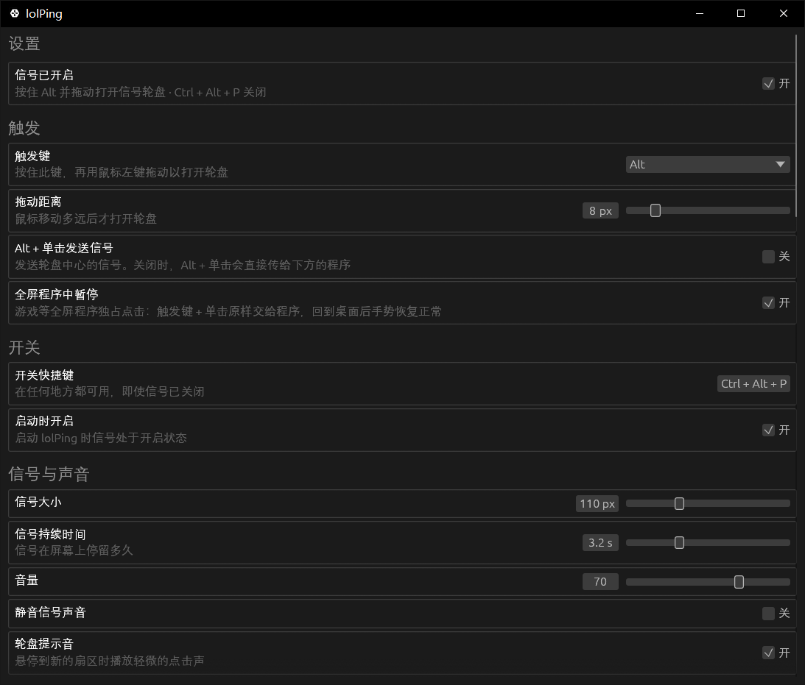

<h1 align="center"><br>lolPing</h1>

<p align="center">
  <a href="README.md">English</a> | 简体中文
</p>

<p align="center">
  把英雄联盟的信号和表情搬到整个桌面，支持 Windows。<br>
  按住 <b>Alt</b> 拖动，在想要的信号上松开：动画弹出、音效响起，任何程序之上、任何显示器上都可以。<br>
  按住 <b>Ctrl</b> 拖动打开表情轮盘：英雄联盟的表情，或你自己的图片。
</p>

<p align="center">
  <a href="https://github.com/SlimeSB/lolPing-rust/releases/latest"><b>下载 Windows 版</b></a>
</p>

<p align="center">
  <a href="https://github.com/SlimeSB/lolPing-rust/releases/latest"></a>
  <a href="LICENSE"></a>
</p>

信号和表情会出现在全屏录制/共享画面里，所以在 Discord 或 OBS 上看你直播的朋友也能看到。lolPing 只是一个桌面小玩具：它不会读取、修改或注入英雄联盟本身。

## 安装

lolPing 由 `lolPing.exe` 和它在运行时读取的 `assets` 文件夹组成。两者要放在一起：分发出去的副本从 exe 旁边的 `assets` 里加载图标、音效和表情。

1. 从[最新版本](https://github.com/SlimeSB/lolPing-rust/releases/latest)获取 `lolPing.exe` 和 `assets`（`lolPing-<version>-win64.zip` 里就是这两样），或者自己构建（见[从源码构建](#从源码构建)）。
2. 运行 `lolPing.exe`。它会打开设置窗口并常驻系统托盘。
3. 按住 Alt 在任意位置拖动即可发信号。

exe 面向 64 位 Windows 构建。程序已在运行时再次启动，只会打开当前那个副本的设置窗口。

## 使用

| 想要 | 操作 |
| --- | --- |
| 发信号 | 按住 **Alt** 拖动，在某个扇区上松开 |
| 发表情 | 按住 **Ctrl** 拖动，在某个表情上松开 |
| 取消 | 在中心松开、点右键，或按 **Esc** |
| 暂停 / 恢复 | **Ctrl + Alt + P** |
| 打开设置 | 单击托盘图标，或右键托盘图标后选择**设置…** |
| 退出 | 右键托盘图标，选择**退出 lolPing** |
| 重启输入助手 | 右键托盘图标，选择**重启输入助手**，仅在助手停止后才会出现 |

轮盘从正上方开始顺时针依次是：危险（撤退）、推进、正在赶来、全力进攻（All In）、请求协助、需要视野、敌人消失、敌方视野。可以在设置中重新排列，或换上诱饵、视野已清除。表情轮盘同样有 8 个扇区，要放哪些表情在设置中选择。

## 设置



- **触发键：** 默认 Alt。还可以选 Ctrl、Shift、Win、Caps Lock、鼠标侧键 4、鼠标侧键 5，或任意其他按键。使用自定义按键时，lolPing 开启期间该键不会在其他程序中输入字符。
- **拖动距离：** 鼠标移动多远后才打开轮盘（2 到 40 像素，默认 8）。
- **Alt + 单击发送信号：** 默认关闭，这样平时的 Alt + 单击快捷操作不受影响。发送的是轮盘中心的信号（默认是普通信号）。
- **全屏程序中暂停：** 默认开启。全屏游戏独占所有点击——触发键 + 单击原样交给程序——回到桌面或在其他显示器上手势恢复正常。窗口化游戏检测不到；任务栏自动隐藏时只识别无边框全屏。
- **开关快捷键：** 默认 Ctrl + Alt + P，必须包含 Ctrl、Alt 或 Win。
- **启动时开启：** 启动 lolPing 时信号处于开启状态。
- **信号与声音：** 信号大小（60 到 220 像素）、信号在屏幕上停留多久（1 到 8 秒）、音量、静音，以及轮盘提示音。
- **轮盘：** 为 8 个扇区各选一个信号，再为中心选一个，也就是 Alt + 单击发送的信号。单击**全部信号**里的信号可以预览。**恢复默认**会还原英雄联盟的布局。
- **表情：** 表情键（默认 Ctrl，也可以关闭）、**Ctrl + 单击发送表情**（默认关闭）、表情大小、表情音效，以及 8 个扇区的表情轮盘（编辑方式和信号轮盘相同）。点**添加图片…**，或把图片拖到窗口上，可以加入自己的图片：PNG、JPG、GIF 或 WebP，最大 8 MB、最长边不超过 8192 像素（动图最大 5 MB、最长边不超过 1024 像素），最多 24 张。动图在你自己这里正常播放；朋友看不到你导入的图片。
- **房间：** 你的名字和名字颜色、**房间静音**、接收信号和表情上限、**允许互联网连接**、**启动时重新加入上次的房间**，以及信号可以落在哪些显示器上。
- **应用：** **开机启动**（启动后隐藏在托盘中）、**语言**（跟随 Windows、English 或简体中文）。
- **关于：** 版本号、缺失或出问题的地方，以及已知限制。

设置在 `%APPDATA%\lolPing\settings.json` 中，导入的图片在 `%APPDATA%\lolPing\emotes` 中。

## 和朋友一起发信号（房间）

加入房间后，房间里的每个人都会在自己的屏幕上看到你的信号：位置相同（按各自的分辨率换算），下面带着你的名字。他们的信号也会出现在你的屏幕上。

1. 一个人打开**设置 → 房间**（或右键托盘图标 → **房间**），点击**创建房间**。
2. 复制房间码（例如 `PING-7KQ4M-2HXTR`）发给朋友。
3. 朋友把它粘贴到房间页面后点击**加入**，或右键托盘图标后点击**从剪贴板加入**。

- **同一网络：** 第一次使用时，Windows 会询问是否允许 lolPing 使用网络：请允许，并把 Wi‑Fi 设置为**专用网络**。如果 lolPing 打不开 UDP 端口 47474，房间页面会提示。
- **不同网络：** 打开**允许互联网连接**（默认开启）后，任何地方的朋友都能用同一个房间码加入。信号通过免费的公共 [Nostr](https://nostr.com) 中继传输，比局域网稍慢一点；能走局域网时仍会优先使用局域网。
- 信号会显示在编号相同的显示器上（1 号是主显示器），没有则显示在 1 号上。
- **表情**和信号一样发给房间：朋友会在自己的屏幕上看到，下面带着你的名字。你导入的图片在他们那里显示为占位图形。版本低于 0.5.0 的朋友看不到表情，房间页面会在他们的名字下面提示。
- **房间静音**、单独静音某个人，以及**接收信号和表情上限**（最高为“不限”，信号和表情合并计算）可以控制刷屏。用快捷键暂停 lolPing 时，房间里的信号和表情也会一起暂停。
- 一个房间最多 8 人。想踢掉某人，就离开并创建一个新房间。
- **隐私：** 信号、表情和名字使用由房间码生成的密钥进行端到端加密。同一网络中的人可以看到你的本地 IP 地址。开启互联网连接后，公共中继可以看到你的 IP 地址、匿名房间 ID 和发送时间，但永远看不到你的信号、表情和名字。

## 已知限制

- 在以管理员身份运行的窗口（例如任务管理器）上无法打开轮盘，因为 Windows 不会把这些窗口的输入交给普通程序。
- 独占全屏的游戏会盖住信号层。
- 只共享单个窗口时看不到信号，请改为共享整个屏幕。
- 开启 lolPing 后，Ctrl + 拖动（默认的表情键）会打开表情轮盘，而不是复制文件或文字。可以在**设置 → 表情**中换一个表情键，或者把它关掉。

## 从源码构建

需要 [Rust 工具链](https://rustup.rs)（stable，edition 2021），以及 Visual Studio Build Tools 中“使用 C++ 的桌面开发”工作负载提供的 MSVC 链接器。`.cargo/config.toml` 会静态链接 C 运行时，所以生成的 exe 在没装 VC++ 运行库的机器上也能运行。

```bash
cargo build --release
```

程序在 `target/release/lolPing.exe`。想一步完成构建并运行：

```bash
cargo run
```

`cargo run` 在任何目录下都能用：程序会先找 exe 旁边的 `assets`，找不到就回退到源码树里的 `assets`。交给别人的副本需要把 `assets` 放在 `lolPing.exe` 旁边。`build.rs` 会把 `build/icon.ico` 和版本信息写进 exe。

| 命令 | 作用 |
| --- | --- |
| `cargo run` | 调试构建，打开设置窗口 |
| `cargo run -- --hidden` | 启动后隐藏在托盘中，开机启动项就是这么拉起它的 |
| `cargo test` | 运行各模块中的单元测试 |
| `cargo build --release` | 在 `target/release/` 中生成优化并剥离符号的 exe |

### 发布新版本

修改 `Cargo.toml` 中的 `version`，提交，然后推送一个与之匹配的标签（例如 `v0.5.1`）。Release 工作流会构建 `lolPing.exe`，并把 `lolPing-<version>-win64.zip`（exe 连同 `assets`）附到 GitHub Release 上。标签和 `Cargo.toml` 里的版本号对不上时，工作流会在发布任何东西之前停下。版本号在编译时写入 exe，显示在**设置 → 关于**中。

## 工作原理

- **输入：** [`src/input/hook.rs`](src/input/hook.rs) 在自己的线程上安装底层鼠标和键盘钩子，并吞掉触发键，使下面的程序完全收不到。[`src/input/decision.rs`](src/input/decision.rs) 是状态机，把这些事件变成“打开轮盘”“在这个扇区上松开”“取消”或“开关”。
- **显示：** [`src/display.rs`](src/display.rs) 枚举显示器，并在物理像素和各显示器 DIP 之间换算。[`src/overlay`](src/overlay) 在每个显示器上用一个可点击穿透、始终置顶的分层窗口绘制轮盘、信号、表情和提示（[`window.rs`](src/overlay/window.rs)），用 tiny-skia 光栅化（[`paint.rs`](src/overlay/paint.rs)），动画在 [`assets.rs`](src/overlay/assets.rs) 中解码。
- **主程序：** [`src/app.rs`](src/app.rs) 是中枢：把钩子事件送到信号层，把设置送到钩子，并把托盘、房间和设置窗口串起来。
- **房间：** [`src/room/manager.rs`](src/room/manager.rs) 管理成员和房间状态。[`crypto.rs`](src/room/crypto.rs) 加密每个数据包（AES-256-GCM，密钥由房间码经 scrypt 和 HKDF 派生），[`lan.rs`](src/room/lan.rs) 通过局域网 UDP 传输，[`relay.rs`](src/room/relay.rs) 和 [`nostr.rs`](src/room/nostr.rs) 则以临时事件的形式通过公共 Nostr 中继传输。
- **设置：** [`src/settings/model.rs`](src/settings/model.rs) 保存默认值、范围限制，以及把磁盘上的任何内容整理成合法 `Settings` 的校验；[`store.rs`](src/settings/store.rs) 负责原子写入。窗口使用 egui/eframe（[`src/settings_window.rs`](src/settings_window.rs)、[`src/settings_window/ui.rs`](src/settings_window/ui.rs)）。
- **表情：** [`src/emotes`](src/emotes) 里是英雄联盟表情目录、格式嗅探，以及把图片缩成表情的导入流程。
- **声音：** [`src/audio.rs`](src/audio.rs) 通过 rodio 播放信号的 WAV 和表情的 Opus 音频。
- **托盘：** [`src/tray.rs`](src/tray.rs) 负责菜单和三种图标状态。
- **设计文档：** [docs/design.md](docs/design.md)。

## 信号素材

`assets/textures` 中的图标和 `assets/sounds` 中的音效提取自本地安装的英雄联盟。`assets/emotes` 中的表情动画、图标和音效同样归 Riot Games 所有。

## 许可证

代码采用 [MIT 许可证](LICENSE)。信号和表情的图标、动画与音效版权归 Riot Games 所有，不在该许可证范围内。如果你代表 Riot Games 并希望移除相关内容，请提交 issue。

lolPing isn't endorsed by Riot Games and doesn't reflect the views or opinions of Riot Games or anyone officially involved in producing or managing Riot Games properties. Riot Games, and all associated properties are trademarks or registered trademarks of Riot Games, Inc.
